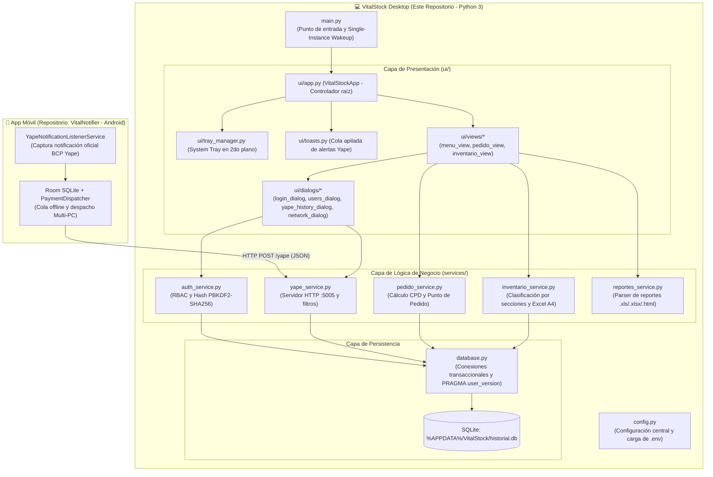

# 💊 VitalStock — Sistema de Gestión de Inventario, Compras y Auditoría de Pagos Yape para Botica


**VitalStock** es una aplicación de escritorio desarrollada en Python (`Tkinter`, `Pandas`, `SQLite`, `OpenPyXL`, `PyStray`) diseñada para resolver tres problemáticas reales de operación en botica:
1. **Reposición Inteligente de Stock (Solo Administración)**: Cruza reportes históricos de ventas con el inventario actual para calcular el Consumo Promedio Diario (`CPD`), Días de Stock, Punto de Pedido y cantidad sugerida a comprar, clasificando cada medicamento por urgencia (`URGENTE`, `POR PEDIR`, `NORMAL`, `SOBRESTOCK`, `SIN ROTACIÓN`).
2. **Formatos de Conteo Físico por Secciones y Laboratorios**: Organiza el catálogo de productos en secciones físicas (`Sección Vitrina`, `Sección Caja`, `Sección Anaquel`, `Sección Almacén`) y genera hojas de conteo en Excel (formato A4 horizontal listas para imprimir), divididas por tablas de laboratorio con columnas de `SISTEMA (UNID / FRAC)` en blanco para conteo físico puro.
3. **Receptor en Tiempo Real de Pagos Yape (`VitalYape`)**: Ejecuta un servidor HTTP local en segundo plano (`puerto 5005`) sincronizado con la app móvil **VitalNotifier (Android)** para alertar en las PCs de caja cada pago Yape entrante mediante notificaciones *Toast* apiladas con alerta sonora, registrando la **fecha y hora exacta en que se realizó el Yape** para cuadres de caja y exportación a Excel.

---

## 🔗 Ecosistema Distribuido: Conexión Funcional con **VitalNotifier (Android)**

Este proyecto forma parte de la suite **VitalStock Suite**, compuesta por dos repositorios complementarios que operan bajo una arquitectura **Cliente-Servidor en Red Local (LAN)**:

| Repositorio | Plataforma / Stack | Rol en la Arquitectura Funcional del Sistema |
| :--- | :--- | :--- |
| **[VitalStock](https://github.com/arocutipaluis/VitalStock)** *(Este repositorio)* | Windows Desktop (`Python 3`, `Tkinter`, `SQLite`, `OpenPyXL`, `PyStray`) | **Servidor Receptor y ERP de Botica**: Corre en las PCs de Caja y Administración. Escucha peticiones en `0.0.0.0:5005`, almacena las transacciones con su hora real en `%APPDATA%/VitalStock/historial.db`, despliega alertas visuales/sonoras y gestiona compras e inventario físico. |
| **[VitalNotifier](https://github.com/arocutipaluis/VitalNotifier)** *(Repositorio complementario)* | Android Nativo (`Kotlin`, `Jetpack Compose`, `Room SQLite`, `OkHttp`) | **Agente Capturador y Despachador Móvil**: Corre en el celular de administración donde está instalada la cuenta de Yape. Intercepta en segundo plano las notificaciones oficiales de `com.bcp.innovacxion.yapeapp`, extrae `remitente`, `monto`, `codigo_seg` y el timestamp exacto (`sbn.postTime` → `fecha_hora`), los encola en SQLite local si no hay Wi-Fi y los despacha vía `HTTP POST /yape` a una o múltiples PCs con **VitalStock**. |

### Flujo de Integración End-to-End (`VitalNotifier` ↔ `VitalStock`)
1. **Captura en Android (`VitalNotifier`)**: El cliente realiza un Yape; Android recibe la notificación del BCP y `YapeNotificationListenerService` extrae el monto, remitente, código de seguridad y el instante exacto de la operación (`dd/MM/yyyy HH:mm:ss`).
2. **Persistencia y Despacho Multi-PC (`VitalNotifier`)**: `PaymentDispatcher` guarda el pago en su base de datos local `Room` con estado `PENDING` y envía el payload JSON mediante `VitalStockClient` (`POST http://<IP_PC>:5005/yape`) a todas las PCs registradas en la botica.
3. **Recepción y Auditoría (`VitalStock`)**: `ServicioNotificacionesYape` recibe el JSON, valida y convierte `fecha_hora` en `database.convertir_fecha_hora_yape()` (preservando la hora real del Yape incluso si el celular estuvo fuera de la red Wi-Fi y sincronizó horas después), guarda el registro en `pagos_yape` y encola el evento hacia `VitalStockApp` para emitir la alerta sonora y mostrar el *Toast* apilado en caja.

---

## 🏗️ Arquitectura del Sistema

El proyecto aplica una **Arquitectura en Capas (Layered Architecture)** combinada con separación **Vista-Controlador-Servicios**, respetando los principios **SOLID**, **DRY** y **KISS**:



### Estructura de Carpetas
```text
VitalStock V1/
├── main.py                      # Punto de entrada principal e inicio en bandeja (System Tray)
├── config.py                    # Fuente única de configuración y variables de entorno (.env)
├── database.py                  # Esquema SQLite, transacciones y motor de migraciones (user_version)
├── services/                    # Capa de Servicios y Reglas de Negocio
│   ├── auth_service.py          # Autenticación PBKDF2-HMAC-SHA256 y control de roles (Admin/Caja/Soporte)
│   ├── yape_service.py          # Receptor HTTP local (:5005), parser regex y consultas por fecha real
│   ├── pedido_service.py        # Algoritmo de recomendación de compra y rotación de stock
│   ├── inventario_service.py    # Gestión de secciones físicas y exportador OpenPyXL (A4)
│   ├── reportes_service.py      # Lector polimórfico de reportes (.xls, .xlsx y tablas HTML)
│   └── seed_data.py             # Semilla inicial de ubicaciones de productos por sección
├── ui/                          # Capa de Presentación Gráfica (Tkinter)
│   ├── app.py                   # Controlador principal, ciclo de eventos y cierre protegido
│   ├── tray_manager.py          # Ícono y menú contextual en la bandeja del sistema (pystray)
│   ├── toasts.py                # Gestor de notificaciones emergentes apiladas (GestorToastsYape)
│   ├── styles.py                # Tema visual institucional ttk
│   ├── widgets.py               # Componentes reutilizables (ZonaDrop Drag&Drop, Tarjeta, Treeview)
│   ├── views/                   # Pantallas principales (base_view, menu_view, pedido_view, inventario_view)
│   └── dialogs/                 # Ventanas modales (login, usuarios, historial Yape, red)
├── tests/                       # Suite de pruebas unitarias, integración y casos borde
│   └── test_vitalstock.py
├── docs/                        # Documentación técnica y especificación de requerimientos
│   └── ARQUITECTURA_Y_REQUERIMIENTOS.md
├── .env.example                 # Plantilla de variables de entorno
└── requirements.txt             # Dependencias del proyecto
```

---

## 🚀 Instalación y Ejecución desde Cero (Guía para el Auditor)

### 1. Prerrequisitos
- **Sistema Operativo**: Windows 10 / 11 (recomendado para soporte nativo de bandeja y audio `winsound`) o cualquier entorno con Python 3.10+.
- **Python**: `3.10` o superior.

### 2. Clonar y configurar el entorno virtual
```powershell
git clone https://github.com/arocutipaluis/VitalStock.git
cd VitalStock

# Crear y activar entorno virtual
python -m venv .venv
.\.venv\Scripts\Activate.ps1

# Instalar dependencias
pip install -r requirements.txt
```

### 3. Variables de Entorno (`.env`)
El sistema incluye valores por defecto seguros para ejecución local inmediata. Si desea personalizar el puerto o credenciales iniciales, copie la plantilla `.env.example`:
```powershell
Copy-Item .env.example .env
```
Variables soportadas en `.env`:
- `VITALSTOCK_PORT=5005`: Puerto TCP del servidor receptor de notificaciones Yape.
- `VITALSTOCK_DB`: Ruta opcional para almacenar la base de datos SQLite (por defecto se ubica en `%APPDATA%\VitalStock\historial.db`).
- `VITALSTOCK_ADMIN_USER` / `VITALSTOCK_ADMIN_DEFAULT_PASS`: Credenciales iniciales del rol Administrador.
- `VITALSTOCK_CAJA_USER` / `VITALSTOCK_CAJA_DEFAULT_PASS`: Credenciales iniciales del rol Caja.

### 4. Iniciar la Aplicación
- **Abrir directamente con ventana visible** (ideal para pruebas y auditoría):
  ```powershell
  python main.py --open
  ```
- **Iniciar en modo predeterminado de producción** (inicia minimizado en la bandeja del sistema junto al reloj de Windows; se abre haciendo doble clic en el ícono de la bandeja o ejecutando nuevamente el acceso directo):
  ```powershell
  python main.py
  ```

---

## 🔐 Credenciales de Prueba (Control de Acceso Basado en Roles - RBAC)

Al iniciar por primera vez, la base de datos crea automáticamente los siguientes perfiles para evaluación:

| Rol | Usuario | Contraseña | Permisos en el Sistema |
| :--- | :--- | :--- | :--- |
| **Administrador** | `admin` | `admin123` | Acceso total a **Recomendación de pedido** (costos y compras), **Formato de inventario**, **Gestión de Usuarios**, **Configuración de Red IP** y autorización de cierre definitivo del programa. *Regla de seguridad: un Administrador no puede modificar ni eliminar la cuenta de otro Administrador.* |
| **Personal de Caja** | `caja` | `caja123` | Acceso a **Formato de inventario** y **Bitácora / Exportación de Pagos Yape**. Tiene bloqueado el módulo estratégico de compras, la gestión de usuarios y la configuración técnica de red. |

---

## 📡 Documentación de la API HTTP Local (`VitalYape`)

El servicio `ServicioNotificacionesYape` (`services/yape_service.py`) levanta un servidor HTTP en `0.0.0.0:5005` para comunicarse con la app móvil **[VitalNotifier](https://github.com/arocutipaluis/VitalNotifier)** y gestionar la instancia única:

### 1. Verificar conectividad (`GET /ping`)
Usado por el botón **"Probar Conexión"** de la aplicación móvil Android.
- **Request**: `GET http://127.0.0.1:5005/ping`
- **Response (`200 OK`)**:
  ```json
  {
    "status": "ok",
    "app": "VitalStock"
  }
  ```

### 2. Registrar notificación de pago Yape (`POST /yape`)
Recibe el objeto JSON enviado por **VitalNotifier**, extrae y persiste la **fecha y hora exacta en que se realizó el Yape** (`fecha_hora`) y dispara la alerta visual y sonora en pantalla.
- **Request**:
  ```bash
  curl -X POST http://127.0.0.1:5005/yape \
    -H "Content-Type: application/json" \
    -d '{
      "remitente": "JUAN PEREZ",
      "monto": 25.50,
      "fecha_hora": "15/10/2026 10:35:12",
      "codigo_seg": "1234",
      "mensaje_raw": "¡Te transfirieron S/ 25.50 de JUAN PEREZ! Cód: 1234"
    }'
  ```
- **Response (`200 OK`)**:
  ```json
  {
    "status": "recibido",
    "id": 1
  }
  ```

### 3. Despertar ventana principal desde segundo plano (`GET /mostrar`)
Permite que al ejecutar nuevamente el acceso directo de `VitalStock`, la instancia que ya corre en la bandeja del sistema restaure su ventana sin duplicar procesos.
- **Request**: `GET http://127.0.0.1:5005/mostrar`
- **Response (`200 OK`)**:
  ```json
  {
    "status": "mostrando",
    "app": "VitalStock"
  }
  ```

---

## 🧪 Ejecución de Pruebas Automatizadas

El repositorio cuenta con pruebas unitarias, de integración y de casos esquina (*Corner Cases*, incluyendo resistencia a inyección SQL, validación de contraseñas, preservación de timestamps diferidos y normalización de secciones) en `tests/test_vitalstock.py`:

```powershell
python -m unittest discover -s tests -v
```

---

## 📦 Compilación del Ejecutable (`.exe`)
Para generar el paquete distribuible de Windows en `dist/VitalStock/VitalStock.exe`:
```powershell
pyinstaller VitalStock.spec --noconfirm
```
